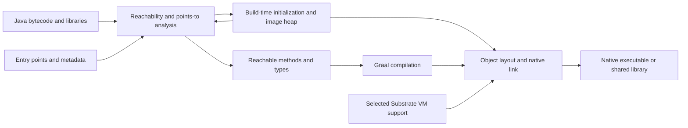

<!-- canonical-language: en; japanese-translation: ja/graalvm-study.md -->

# GraalVM ideas for the lang compiler and runtime

[日本語版](ja/graalvm-study.md)

Research verified **2026-10-30 JST**. Review outcome: **needs prototype/measurement**. This is a research review, not an accepted implementation RFC or an addition to the active milestone queue.

**The strongest opportunity is to adapt Native Image's reachability analysis, build explanations and controlled specialization to the existing Rust/MIR/Cranelift pipeline. Replacing that pipeline with GraalVM is not justified by the current requirements or evidence.** The project already has AOT, JIT, a verified VM and explicit ownership; Java's gains from removing JVM startup do not measure the remaining opportunity here.

The comparison uses clean project commit [`0a15fb5`](https://github.com/carimatics/lang/commit/0a15fb5cb2bf75f8b46b025476441a71eb2a8960), committed 2026-10-29, and Graal source snapshot [`0a433ac`](https://github.com/oracle/graal/tree/0a433ac6cca36ba2ba601ea871231b109754f2eb), committed 2026-10-29 09:57 UTC. The project snapshot deliberately excludes another session's uncommitted native-link work and its unmerged DAP branch. Recommendations below are hypotheses unless identified as existing behavior or an experiment result. Source dates and scope are recorded in the registry.

## Current GraalVM landscape

GraalVM contains several related systems; their responsibilities should not be conflated. [S1]

| System | Responsibility | Relevance to lang |
| --- | --- | --- |
| Graal compiler | Optimizing compiler used for Java JIT and Native Image compilation; integrates with the JVM through JVMCI | Optimization architecture and measurement, not a ready-made Rust MIR backend |
| Native Image and Substrate VM | Analyze a Java application and build native code together with a specialized runtime and initial heap | Whole-program composition, startup work, code/data footprint and build tooling |
| Truffle | Language implementation framework using interpreters, specialization and partial evaluation | An alternative language-engine architecture, or a source of interpreter optimization ideas |
| Polyglot embedding | Contexts, host/guest access and language interoperability | Explicit boundary policy and lifecycle design |
| Sulong | LLVM bitcode execution using Truffle | A separate route requiring LLVM bitcode; it does not consume the current Cranelift objects as guest IR |
| Espresso, GraalWasm and tools | Java-on-Truffle, WebAssembly execution, instrumentation and debugging | Useful examples of multiple runtimes sharing tooling; not proof that adding another frontend is cheap |

The Graal compiler itself can be built as `libgraal`, a Native Image shared library used by HotSpot. This removes the compiler's own Java warmup and separates its heap from the application heap; it does not expose a stable, backend-neutral compiler service suitable for arbitrary MIR. [S1]

Version distinctions matter as of this review:

- Community release notes and the distribution repository identify **25.4.4.1.1**, released **2026-09-22**, as the current listed innovation release. Oracle's innovation notes identify the same Graal release, based on JDK 25.0.4.1. Graal's innovation numbering is not the current Java feature-version number. [S2], [S3]
- Oracle's **25.0 LTS** release page has a **25.0.5.0.3** entry dated **2026-10-26**. A newer patch date on that line does not make it the innovation feature baseline. [S4]
- The inspected development source includes a **25.5** changelog section. A source-tree entry is not evidence of a published release; development features are not treated as production dependencies here. [S23]
- Edition and target restrictions apply. Current documentation marks PGO and the HTML Build Report unavailable in Community Edition; G1 is also non-Community and is documented for Linux AMD64/AArch64. These features must not be assumed available on lang's macOS AArch64 and Windows x86-64 targets. [S8], [S9], [S10], [S11]

## How Native Image works



### Reachability and the closed world

Native Image starts from entry points and registered roots, discovers reachable methods, types, fields and objects, and iterates until analysis reaches a fixed point. Points-to information makes virtual-call targets more precise than retaining every possible implementation. Reachability removes unnecessary program elements; subsequent compiler optimizations simplify the retained code. This is broader than a linker removing unreferenced sections. [S5], [S19]

The source divides these responsibilities: `PointsToAnalysis` handles type-flow analysis; `NativeImageGenerator` coordinates analysis, compilation and image generation; `NativeImageHeap` discovers and lays out retained objects. Their integration with Java class loading, reflection, JVMCI and the hosted build environment explains why extracting one subsystem into this Rust compiler would be substantial work. [S19]

The ordinary closed-world model assumes the build can account for the code needed at run time. Reflection, JNI, dynamic proxies, resource lookup and similar operations may hide dependencies from static analysis. Reachability metadata supplies those missing edges. Conditional metadata limits over-retention; tracing an application can help discover accesses, but an observed execution cannot prove that every production path was covered. Metadata is a correctness input, not merely a size-tuning hint. [S6]

There is an important current exception: the 25.1 innovation release introduced **early dynamic class loading** with `-H:+RuntimeClassLoading`. Current source documentation calls this **Crema** and describes optional runtime JIT compilation with `-H:+GraalJITCompileAtRuntime`. It also documents limits, including errors when runtime-loaded code needs methods or static fields already removed from image classes. Consequently, “Native Image can never load new classes” is too broad; “ordinary closed-world AOT, with separately enabled evolving dynamic support” is the useful distinction. Do not infer JVM-wide compatibility or a stable plugin ABI from these options. [S18], [S22]

### Build-time execution and the image heap

Native Image can execute class initialization while building and retain resulting object state in the binary. This can eliminate repeated initialization work and associated runtime checks. It also creates a semantic boundary: a build-time environment variable, clock value, random seed or machine-specific setting can become deployment-time state unless initialization policy prevents it. Explicit runtime initialization remains necessary for environment-sensitive behavior. [S5], [S7]

For lang, the transferable idea is **precompute safe immutable data**, such as lookup tables or validated constant structures. It is not to serialize arbitrary live Rust/runtime objects. File descriptors, capability grants, host callbacks, locks, allocator identities, borrowed values, shared/weak ownership and arena generations must not become portable frozen state. A proposed constant evaluator would need bounded work/allocation, explicit input capture, target-defined layout and endianness, deterministic failure, and no ambient filesystem/network/environment access. Its effects on allocation accounting, failure timing and deterministic destruction require an RFC. [L1], [L2], [L3]

### A native image still has a runtime

Native Image removes the need to start HotSpot for an ordinary native executable; it does not remove Java's runtime requirements. Allocation, GC, exception handling, threads, metadata and native boundaries still need support. Serial GC is the documented default; Epsilon's lack of collection means allocations are not reclaimed, not that Java objects acquire deterministic ownership. [S8]

The project's ordinary values are moved and destroyed deterministically; explicit shared/weak references and lexical arenas have their own contracts. Substrate VM's tracing heap is therefore not a substitute for the runtime described by RFCs 0004 and 0012. Importing it would change semantics and operational costs. Selectively including runtime facilities is still relevant, independently of the memory-management strategy. [L2], [L3]

### Profiles, reports and reproducibility

Native Image's PGO workflow builds an instrumented executable, runs representative workloads and rebuilds using the collected profile. It can inform inlining, branch decisions and other optimizations, but profile quality and workload changes determine whether it helps. A Graal profile is not directly usable by Cranelift or by rustc. [S9]

Build output reports reachable elements, code/heap size, origins, build phases and resource use. The optional HTML report adds navigable detail. This suggests a useful lang artifact: explain **why a function/runtime feature is included**, where its size comes from, and which phase consumes build time. It is more actionable than a single executable-size number. [S10], [S11]

Native Image bundles capture inputs, options and environment information for replay. Experimental layered images reuse earlier image-building work, with explicit compatibility restrictions; current Native Build Tools supports layer consumption on 25.1 and later while warning that 25.0.x consumption is unsupported. Bundling, caching and layering are distinct: none alone proves hermetic or byte-identical builds. [S12], [S13]

lang already freezes package sources, hashes lock/compiler/SDK inputs and publishes native build receipts. Start by extending this foundation, not by adding a parallel build manifest. A future cache must key target/CPU features, compiler and runtime identity, optimization/debug settings, root selection and any profile or constant-evaluation inputs. Cache replay must revalidate formats and capabilities; cached analysis is not authority. The simpler alternative to image layers is a content-addressed cache of verified analysis and ordinary native objects. [L1], [L5]

## Truffle ideas and their limits

Truffle specializes a language interpreter using a particular guest program and stable profiling state. Graal partially evaluates the interpreter, folds known values, inlines operations and emits residual machine code. Speculative assumptions require invalidation and deoptimization, including reconstructing interpreter frames when assumptions fail. A Java interpreter written without those contracts does not automatically become an efficient optimizing compiler. [S14]

The Bytecode DSL generates interpreter machinery, including tiered uncached/cached interpretation, quickening, specialization, source instrumentation, continuations and serialization support. Its documentation lists some further optimizations as future work; those should not be presented as implemented features. The design lesson is to share operation definitions and source mappings across execution tiers while controlling specialization growth. [S15]

lang already lowers typed MIR to machine code rather than partially evaluating a Java interpreter. Adopting Truffle directly would require a Java-based language engine or a substantial bridge, duplicate semantic enforcement, introduce a managed host runtime, and reconcile ownership/cancellation/ABI/debugging with Truffle. Shipping that interpreter in a Native Image would compile the interpreter and selected support; it would not automatically AOT-specialize every guest script that arrives later. Guest compilation and its footprint remain separate policy choices. [S1], [S14]

Smaller transferable experiments are more promising:

- Predecode verified bytecode into an internal execution representation, preserving canonical portable bytes.
- Specialize frequently executed operations or combine a short sequence into a superinstruction only when measurement identifies dispatch overhead.
- Keep source spans and original semantic charge points so stepping, traps, fuel exhaustion and cancellation retain the same behavior.
- Bound specialization count, memory and invalidation work. A profile may guide optimization but cannot justify dropping a possible target or capability check.

An internal execution cache need not change the serialized schema. Changes to observable fuel, failure timing, source stepping or cancellation require revising the relevant contracts before implementation. A general speculative deoptimizer is a much larger undertaking than local bytecode specialization. [L1], [L2], [L3], [L4]

## What already exists in this project

| Existing implementation at the pinned project revision | Consequence for the comparison |
| --- | --- |
| Typed MIR, verified portable execution and Cranelift JIT/AOT | “Add native compilation” is not a new proposal |
| Separate Copy, ownership and task execution representations | One physical reachability pass cannot be assumed to fit every profile |
| `codegen-clif/src/program.rs` declares all unit functions as exported; ordinary owned emission iterates all verified flow functions | There is a concrete place to investigate narrowing the emitted function set |
| `codegen-clif/src/tasks.rs::reachable_program` already walks entry-rooted `Call` and `TaskSpawn` edges | Reuse and generalize this idea; do not claim the repository lacks reachability analysis |
| Native compiler records, function IDs, debug ranges and generated bindings | Removing code must keep records, remapping, validation and debugging coherent |
| Frozen package inputs, exact SDK/compiler checks and build receipts | Build reproduction has an existing foundation |
| Capability-gated components and trusted native boundaries | Reachability or a compact runtime cannot grant permissions or sandbox native callbacks |

These observations come from source inspection, not a claim that every native export or every service edge is already handled by a single algorithm. Full language validation must still run before optimization; dead-code removal must not make invalid source silently acceptable. [L1], [L2], [L3], [L4], [L5], [L7]

Existing performance evidence also changes the priorities. The 2026-10-27 M3 capture reports a component JIT path that compiles inside each measured call, whereas task measurements reuse compiled entries. Its component medians were 94.292 µs for VM and 1,267.583 µs for JIT including compilation. These are historical, workload-specific figures, not current universal call costs. They suggest measuring compilation reuse and common runtime preparation before assuming a more sophisticated compiler will solve the dominant cost. The same report cautions that close task VM/JIT timings include shared preparation and retirement. [L6]

## Executable reachability experiment

The experiment used an independent worktree and an independent Cargo target directory at project commit `0a15fb5`. Host: Apple M1 Max, macOS 27.2, arm64; Rust 1.99.0 (`b940084d7`, 2026-09-28); compiler built with Cargo's default dev profile and the native CLI's default settings. Verified 2026-10-30 JST. No production source was modified.

Three inputs isolate an unused function from a called one:

```text
base.lang
fn main() -> i64 { return 42; }

dead.lang
fn main() -> i64 { return 42; }
fn spare() -> i64 { return 43; }

live.lang
fn main() -> i64 { return spare(); }
fn spare() -> i64 { return 43; }
```

Reproduce by writing those UTF-8 files under `target/graal-study/`, then using fresh output directories:

```bash
cargo build --locked --bin lang
for name in base dead live; do
  target/debug/lang native --output "target/graal-study/$name-native" "target/graal-study/$name.lang"
  target/debug/lang run "target/graal-study/$name.lang"
  nm -g "target/graal-study/$name-native/program.o"
  size -m "target/graal-study/$name-native/program.o"
  wc -c "target/graal-study/$name-native/program.o" "target/graal-study/$name-native/program.lbc" "target/graal-study/$name-native/program.native"
done
```

| Fixture | VM result | Defined `_lang_unit_f*` symbols | Mach-O `__text` bytes | Object bytes | Portable bytes | Native record bytes |
| --- | ---: | ---: | ---: | ---: | ---: | ---: |
| base | 42 | 1 | 44 | 944 | 173 | 1,102 |
| dead | 42 | 2 | 88 | 1,248 | 294 | 1,474 |
| live | 43 | 2 | 128 | 1,296 | 299 | 1,542 |

All native-generation and VM commands succeeded. The unused function is retained as a defined native symbol: `dead` adds 44 bytes of text and 304 bytes of total object data over `base`. The total includes debug and symbol information; it is not 304 bytes of machine code. Portable and native-record growth also shows that a coherent optimization must consider associated artifacts.

This establishes an **emission opportunity in this Copy fixture**. It does not establish final linked executable savings, startup/RSS changes, compilation-speed improvements, owned/task behavior, or Windows behavior. No native executable was linked or executed in this experiment. No GraalVM performance comparison was run; `native-image` was not installed. Native/VM equivalence of a future elimination pass still needs dedicated tests.

## Recommended application order

Priority here is a research recommendation, not milestone points or scheduled work.

| Priority | Idea | Fit and expected benefit | Main condition or cost |
| --- | --- | --- | --- |
| 1 | Explainable reachability and size report | High: use existing graphs/records to expose retained roots, functions, helper dependencies and size attribution | Bound analysis and report size; preserve deterministic ordering and source provenance |
| 1 | Entry-rooted elimination for ordinary native programs | High: the Copy experiment demonstrates retained unused code; task lowering supplies a local precedent | Define all exports, callbacks, cleanup/destructor edges and entry profiles; retain valid record/debug mappings |
| 1 | Measure component compilation reuse | High: historical evidence includes repeated JIT compilation | Cache code/immutable plans only; keep instance resources, grants, controls and mutable state separate |
| 2 | Runtime feature inventory and specialization | Medium/high: select necessary helper families for a program | First measure linker behavior and Rust runtime granularity; more runtime variants increase SDK compatibility/testing cost |
| 2 | Shared MIR simplification and internal VM specialization | Medium: constant propagation, safe local simplification and dispatch reduction can benefit existing paths | Preserve failures, ownership, budgets, spans and cancellation; cap code growth |
| 2 | Build-report and replay-bundle improvements | High compatibility with existing package snapshots/receipts | Explicit environment/toolchain inputs; distinguish deterministic content from machine-specific paths and diagnostics |
| 3 | Restricted immutable precomputation | Medium: potential startup/allocation reduction | Needs semantic design for effects, target layout, accounting, failures and serialized constants |
| 3 | Profiles for selective optimization | Medium: useful after bottleneck and stable identity measurements | Workload coverage, schema/versioning, stale-profile rejection and backend-specific consumers |
| Defer | Native image layers and general heap snapshots | Limited immediate need | Large compatibility surface; immutable object caching is the simpler first experiment |
| Defer | Truffle rewrite, Graal backend or speculative deoptimization engine | Low current fit | Major runtime/backend/toolchain change without a measured benefit over improving the existing pipeline |

### Reachability needs explicit roots

A future pass should operate on independently validated, backend-neutral program facts, then feed native emission and optional reports. Its roots depend on the artifact: a standalone executable's entry differs from a C library's exports, a component's callable exports, a REPL's retained definitions, or a package's selected tests. Edges include ordinary calls, task spawns, callbacks, teardown/cleanup, runtime helper dependencies and any indirect callable sets admitted by the language. Conservatively retain unknown possible targets; report the retention reason instead of guessing.

Keep separate the source language's `pub` visibility, a package/interface export and the current backend's `Linkage::Export`. They are not interchangeable. Public library functions may be called by future consumers even when the current executable has no call edge. A closed executable can be aggressively specialized while verified scripts/components retain their existing open loading boundary. Component metadata should describe required imports and exports, not grant host capabilities. [L1], [L4], [L7]

Begin with a read-only reachability report for one Copy executable. Next compare emitted and linked results with and without elimination. Only then decide how to represent selected functions without breaking dense IDs, portable semantics, native record verification, code ownership or debug ranges. Introducing an externally persisted root/feature manifest or changing record layouts requires a versioned RFC and migration plan; an internal analysis alone need not change the ABI.

### Specialization must preserve the cost and failure model

Do not simply remove an allocation, ownership check or interrupt poll because it appears unnecessary to the final return value. Allocation limits, destruction order, host calls, fuel, service work, cancellation and error spans can be observable. For example, fusing several VM instructions must still fail at the same semantic charge point when fuel runs out. Hoisting capability preflight across a callback can change which effects occur before denial. A fast path needs either a proof under the existing profile or an explicitly revised profile, plus a fallback where appropriate. [L1], [L2], [L3], [L4]

For profile-guided work, distinguish three consumers: optimizing the Rust compiler executable, optimizing the Rust runtime/SDK, and optimizing generated guest code. Applying Rust PGO to the first two does not automatically optimize the third. Prefer stable source/MIR identities over native addresses; include the program/compiler/target/profile schema in the key, reject malformed or stale profiles, and measure training and held-out workloads separately. [S9], [L5]

## Direct integration alternatives

| Option | Assessment |
| --- | --- |
| Keep the current architecture | Valid baseline; measure improvements against it rather than assuming a backend replacement is needed |
| Adapt ideas in Rust/MIR/Cranelift | Recommended: smallest semantic disruption, existing conformance suite, incremental evidence |
| Use linker maps, existing profilers and object inspection first | Strong simple alternative; identifies whether size/time is in guest code, runtime, debug data or toolchain before adding passes |
| Embed a Java service compiled by Native Image through C | Plausible only for a concrete Java-library requirement; Native Image supports shared libraries and C entry points. It needs explicit isolate/thread lifecycle, resource ownership, exception/status conversion and capability policy. It is not direct compilation of lang source. [S16] |
| Reimplement lang on Truffle | Consider only if deep JVM/polyglot integration becomes a primary product requirement; otherwise duplicates a functioning language implementation |
| Emit LLVM bitcode and use Sulong | Requires a new backend and runtime integration; benchmark against direct LLVM AOT as well. It does not follow from having native object files. [S21] |
| Add LLVM as an optimizing AOT backend | A separate competing design if measurements show Cranelift code quality dominates; must preserve MIR, ABI and both-platform conformance, and account for compile/distribution cost |

Licensing also distinguishes idea reuse from source reuse. The Graal repository contains GPLv2 with Classpath Exception-designated files and separately licensed components; Truffle documents UPL licensing. An Oracle distribution's available features are not evidence that its implementation is in the Community source tree. Any concrete code or binary adoption needs component-specific license and distribution review, while this recommendation is to independently implement the selected ideas. [S20]

Polyglot isolates and sandbox policies offer useful boundary patterns, but an isolate is not automatically an untrusted-code sandbox. Graal's policies separately constrain host access, resources and execution; exported host code remains part of the attack surface. Preserve lang's distinction between trusted native code and capability-restricted script execution. A smaller binary or an AOT image does not make arbitrary native callbacks safe. [S17], [L4]

## Validation and decision gates

The next executable experiment should extend the small reachability fixture, rather than introduce another runtime. A proposed sequence is:

1. **Explain retention:** report roots/edges for Copy executables and contrast with the existing task walk. Include an otherwise unused ordinary function, a callable export, a callback, recursion, task spawn and cleanup paths. Preserve rejection of malformed source and records.
2. **Test elimination:** compare VM/JIT/AOT results, host effects, destruction traces, failures/spans, fuel/cancellation and debug locations. Test a live function that looks unused from `main` but is externally callable. Revalidate every changed artifact and reject stale record/root combinations.
3. **Measure the whole product:** record object text/data/debug bytes, portable/native metadata, final executable/dependency size, cold startup, steady-state throughput, process RSS and managed allocations separately. Separate frontend, analysis, code generation, link, JIT preparation and per-call runtime work.
4. **Evaluate reuse and specialization:** instrument compilation count and helper/runtime preparation before adding PGO or a new optimizer. Cache lifetime tests must cover unload, grant changes, cancellation, concurrent instances and code borrowing.

Use the existing M2 source/Rust/C and M3 workload families as semantic/measurement anchors, with named clean revisions, exact toolchains, raw samples and variance. Repeat relevant native work on macOS AArch64 and Windows x86-64. A performance claim needs both representative workloads and a stated regression budget; no universal percentage threshold is established by this review. [L6]

Decision-blocking questions are the complete root set per artifact profile, the compatibility representation for removed functions, and whether final-link/runtime cost actually dominates. Optional later work includes immutable constant evaluation, richer profiles and object caching. The favorable local size observation is enough to prioritize a prototype, not to accept a new ABI, revise ownership semantics or interrupt the active M4 work.

## Source registry

All sources below were verified **2026-10-30 JST**. A release-entry date is not represented as the webpage's last-modified date. Living documentation without a published update date is explicitly marked; no date is inferred from search-engine crawl times. Pinned source files have no separately published document-update date here; the source snapshot commit date is stated instead.

| ID | Primary source | Publication or update information |
| --- | --- | --- |
| S1 | [Graal README][S1], [compiler README](https://github.com/oracle/graal/blob/0a433ac6cca36ba2ba601ea871231b109754f2eb/compiler/README.md), [Truffle README](https://github.com/oracle/graal/blob/0a433ac6cca36ba2ba601ea871231b109754f2eb/truffle/README.md) | Document update dates not published; pinned source snapshot 2026-10-29 |
| S2 | [Community 25.4 release notes][S2], [distribution release](https://github.com/graalvm/graalvm-ce-builds/releases/tag/graal-25.4.4.1.1) | Release 2026-09-22; GitHub release updated 2026-09-22; notes page update date not published |
| S3 | [Oracle innovation release notes][S3] | 25.4.4.1.1 entry 2026-09-22; page update date not published |
| S4 | [Oracle 25 LTS release notes][S4] | 25.0.5.0.3 entry 2026-10-26; page update date not published |
| S5 | [Native Image basics][S5] | Update date not published |
| S6 | [Reachability metadata][S6] | Update date not published |
| S7 | [Class initialization][S7] | Update date not published |
| S8 | [Memory management][S8] | Update date not published |
| S9 | [Profile-guided optimization][S9] | Update date not published |
| S10 | [Build output][S10] | Update date not published |
| S11 | [Build Report][S11] | Update date not published |
| S12 | [Native Image bundles][S12] | Update date not published |
| S13 | [Layered images in Native Build Tools][S13] | Documentation version 1.1.18; update date not published; experimental feature |
| S14 | [Partial evaluation in Truffle][S14] | Document update date not published; development source snapshot 2026-10-29 |
| S15 | [Bytecode DSL introduction][S15] | Document update date not published; development source snapshot 2026-10-29 |
| S16 | [Native shared library guide][S16] | Update date not published |
| S17 | [Polyglot sandboxing][S17] | Update date not published |
| S18 | [Runtime class loading][S18] | Document update date not published; development source snapshot 2026-10-29 |
| S19 | [PointsToAnalysis][S19], [NativeImageGenerator](https://github.com/oracle/graal/blob/0a433ac6cca36ba2ba601ea871231b109754f2eb/substratevm/src/com.oracle.svm.hosted/src/com/oracle/svm/hosted/NativeImageGenerator.java), [NativeImageHeap](https://github.com/oracle/graal/blob/0a433ac6cca36ba2ba601ea871231b109754f2eb/substratevm/src/com.oracle.svm.hosted/src/com/oracle/svm/hosted/image/NativeImageHeap.java) | No document update date; source snapshot 2026-10-29 |
| S20 | [Graal LICENSE][S20] and Truffle README in S1 | No document update date; source snapshot 2026-10-29 |
| S21 | [Sulong README][S21] | Document update date not published; source snapshot 2026-10-29 |
| S22 | [Community 25.1 release notes][S22] | Release entry 2026-06-30; page update date not published |
| S23 | [Native Image development changelog][S23] | Source snapshot 2026-10-29; the 25.5 section is not used as release evidence |
| L1 | [Project architecture](architecture.md) | Last source commit at the inspected revision: 2026-10-29 |
| L2 | [RFC 0004 ownership](rfcs/0004-owned-values-and-cyclic-graphs.md) | Last source commit: 2026-10-28 |
| L3 | [RFC 0012 native continuations](rfcs/0012-native-ownership-continuations.md) | Last source commit: 2026-10-28 |
| L4 | [RFC 0027 component interface](rfcs/0027-production-component-interface.md) | Last source commit: 2026-10-28 |
| L5 | [RFC 0034 packages](rfcs/0034-package-workspaces-and-cli-diagnostics.md), [native package composition](../src/package/native.rs) | Last source commits: 2026-10-29 |
| L6 | [Benchmark evidence](benchmarks.md) | M3 protocol updated 2026-10-28; cited measurements 2026-10-27 |
| L7 | [Copy codegen](../crates/codegen-clif/src/program.rs), [owned codegen](../crates/codegen-clif/src/owned.rs), [task codegen](../crates/codegen-clif/src/tasks.rs) | Last source commits: 2026-10-20, 2026-10-22 and 2026-10-27 respectively |

[S1]: https://github.com/oracle/graal/blob/0a433ac6cca36ba2ba601ea871231b109754f2eb/README.md
[S2]: https://www.graalvm.org/release-notes/25.4/
[S3]: https://docs.oracle.com/en/graalvm/jdk/25i/docs/release-notes/index.html
[S4]: https://docs.oracle.com/en/graalvm/jdk/25/docs/release-notes/
[S5]: https://www.graalvm.org/latest/reference-manual/native-image/basics/
[S6]: https://www.graalvm.org/latest/reference-manual/native-image/metadata/
[S7]: https://www.graalvm.org/latest/reference-manual/native-image/optimizations-and-performance/ClassInitialization/
[S8]: https://www.graalvm.org/latest/reference-manual/native-image/optimizations-and-performance/MemoryManagement/
[S9]: https://www.graalvm.org/latest/reference-manual/native-image/optimizations-and-performance/PGO/
[S10]: https://www.graalvm.org/latest/reference-manual/native-image/overview/BuildOutput/
[S11]: https://www.graalvm.org/latest/reference-manual/native-image/overview/build-report/
[S12]: https://www.graalvm.org/latest/reference-manual/native-image/overview/Bundles/
[S13]: https://graalvm.github.io/native-build-tools/latest/layered-images.html
[S14]: https://github.com/oracle/graal/blob/0a433ac6cca36ba2ba601ea871231b109754f2eb/truffle/docs/PartialEvaluation.md
[S15]: https://github.com/oracle/graal/blob/0a433ac6cca36ba2ba601ea871231b109754f2eb/truffle/docs/bytecode_dsl/BytecodeDSL.md
[S16]: https://www.graalvm.org/latest/reference-manual/native-image/guides/build-native-shared-library/
[S17]: https://www.graalvm.org/latest/security-guide/sandboxing/
[S18]: https://github.com/oracle/graal/blob/0a433ac6cca36ba2ba601ea871231b109754f2eb/substratevm/docs/runtime-class-loading.md
[S19]: https://github.com/oracle/graal/blob/0a433ac6cca36ba2ba601ea871231b109754f2eb/substratevm/src/com.oracle.graal.pointsto/src/com/oracle/graal/pointsto/PointsToAnalysis.java
[S20]: https://github.com/oracle/graal/blob/0a433ac6cca36ba2ba601ea871231b109754f2eb/LICENSE
[S21]: https://github.com/oracle/graal/blob/0a433ac6cca36ba2ba601ea871231b109754f2eb/sulong/README.md
[S22]: https://www.graalvm.org/release-notes/25.1/
[S23]: https://github.com/oracle/graal/blob/0a433ac6cca36ba2ba601ea871231b109754f2eb/substratevm/CHANGELOG.md
[L1]: architecture.md
[L2]: rfcs/0004-owned-values-and-cyclic-graphs.md
[L3]: rfcs/0012-native-ownership-continuations.md
[L4]: rfcs/0027-production-component-interface.md
[L5]: rfcs/0034-package-workspaces-and-cli-diagnostics.md
[L6]: benchmarks.md
[L7]: ../crates/codegen-clif/src/tasks.rs
