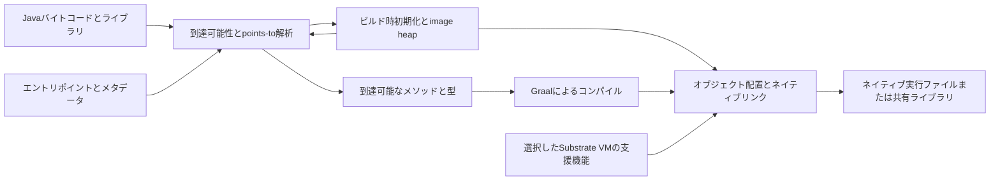

<!-- translation-of: ../graalvm-study.md; canonical-language: en -->

# GraalVMのアイデアをlangのコンパイラとランタイムに活用する

[English](../graalvm-study.md)

調査確認日：**2026-10-30 JST**。レビュー判定：**試作・測定が必要（needs prototype/measurement）**。本書は調査レビューであり、実装を承認するRFCや、現在のマイルストーンへの作業追加ではありません。

**最も有望なのは、Native Imageの到達可能性解析、ビルド内容の説明、制御された特殊化を、既存のRust／MIR／Cranelift構成に取り入れることです。現在の要件と証拠からは、GraalVMによる置き換えは正当化できません。** このプロジェクトにはすでにAOT、JIT、検証済みVM、明示的な所有権があります。JavaでJVM起動を省く効果を、そのまま本プロジェクトの改善余地とみなすことはできません。

比較対象は、2026-10-29にコミットされたクリーンなプロジェクト版[`0a15fb5`](https://github.com/carimatics/lang/commit/0a15fb5cb2bf75f8b46b025476441a71eb2a8960)と、2026-10-29 09:57 UTCにコミットされたGraalソース版[`0a433ac`](https://github.com/oracle/graal/tree/0a433ac6cca36ba2ba601ea871231b109754f2eb)です。プロジェクト側には、別セッションの未コミットのnative-link変更と未マージのDAPブランチを含めていません。以下の提案は、既存動作・実験結果と明記したものを除き仮説です。情報源の日付と適用範囲は末尾に記載します。

## 現在のGraalVMの構成

GraalVMは複数の関連システムからなり、それぞれの役割を区別する必要があります。[S1]

| システム | 役割 | langとの関係 |
| --- | --- | --- |
| Graal compiler | Java JITとNative Imageで用いる最適化コンパイラ。JVMCI経由でJVMと連携 | 最適化設計・測定の参考。RustのMIRをそのまま受け取るバックエンドではない |
| Native ImageとSubstrate VM | Javaアプリを解析し、必要なランタイムと初期ヒープを組み込んだネイティブコードを構築 | プログラム全体の構成、起動処理、コード・データサイズ、ビルドツールの参考 |
| Truffle | インタプリタ、特殊化、部分評価による言語実装フレームワーク | 言語エンジンの代替設計、またはインタプリタ最適化の参考 |
| Polyglot embedding | コンテキスト、ホスト・ゲスト間アクセス、言語間連携 | 境界ポリシーとライフサイクルの参考 |
| Sulong | TruffleによるLLVM bitcode実行 | LLVM bitcodeが必要な別経路。現在のCraneliftオブジェクトをゲストIRとして読み込むものではない |
| Espresso、GraalWasm、各種ツール | Truffle上のJava、WebAssembly実行、計測・デバッグ | 複数ランタイムでツールを共有する例。別フロントエンドを安価に追加できる根拠ではない |

Graal compiler自身をNative Imageの共有ライブラリ`libgraal`にしてHotSpotで利用する構成もあります。コンパイラ自身のJavaウォームアップを省き、アプリとは別のヒープを使えます。ただし、任意のMIRに対応する安定したバックエンド非依存のコンパイラサービスを公開するものではありません。[S1]

調査日時点では、次の版の違いが重要です。

- Communityのリリースノートと配布リポジトリで現在掲載されているinnovation版は、**2026-09-22**公開の**25.4.4.1.1**です。Oracleのinnovation版も同じGraalリリースで、JDK 25.0.4.1ベースと説明されています。Graalのinnovation版番号と、その時点のJava機能リリース番号は別物です。[S2], [S3]
- Oracleの**25.0 LTS**のページには、**2026-10-26**付の**25.0.5.0.3**があります。LTSのパッチ日が新しくても、innovation版の機能基準になるわけではありません。[S4]
- 調査した開発ソースの変更履歴には**25.5**の節があります。ソース上の記載だけで公開済みとは判断せず、開発版の機能を本番依存の前提にしていません。[S23]
- エディション・対象環境による制限があります。現行文書ではPGOとHTML Build ReportはCommunity Editionでは利用できず、G1も非Community機能でLinux AMD64／AArch64向けとされています。langのmacOS AArch64／Windows x86-64で利用できると仮定してはいけません。[S8], [S9], [S10], [S11]

## Native Imageの仕組み



### 到達可能性と閉世界モデル

Native Imageはエントリポイントと登録されたルートを起点に、到達可能なメソッド、型、フィールド、オブジェクトを見つけ、不動点に達するまで解析を繰り返します。points-to情報によって、仮想呼び出しの候補を全実装の保持より精密に絞れます。到達可能性解析で不要な要素を除き、残ったコードにはコンパイラ最適化を適用します。リンカが未参照セクションを除去する処理より広い範囲を扱います。[S5], [S19]

ソースでは、`PointsToAnalysis`が型フロー解析、`NativeImageGenerator`が解析・コンパイル・イメージ生成の統括、`NativeImageHeap`が保持オブジェクトの探索・配置を担います。Javaのクラスロード、リフレクション、JVMCI、ビルド時の実行環境と結び付いており、一部分をこのRustコンパイラに移植するだけでも相当な作業になります。[S19]

通常の閉世界モデルでは、実行時に必要なコードをビルド時に把握できることを前提とします。リフレクション、JNI、動的プロキシ、リソース検索などは静的解析から依存を隠すため、reachability metadataで不足する辺を補います。条件付きメタデータは過剰な保持を抑えます。実行トレースによるアクセス収集も役立ちますが、観測した実行だけでは全本番経路の網羅を証明できません。メタデータはサイズ調整だけでなく、正しい実行のための入力です。[S6]

現在は重要な例外があります。25.1 innovation版は、`-H:+RuntimeClassLoading`による**初期段階の動的クラスロード**を導入しました。現行ソース文書ではこれを**Crema**と呼び、`-H:+GraalJITCompileAtRuntime`による任意の実行時JITも説明しています。一方で、実行時ロードしたコードが、イメージ内のクラスから解析で除去済みのメソッドやstaticフィールドを必要とするとエラーになるなどの制限があります。したがって「Native Imageは新しいクラスを一切ロードできない」ではなく、「通常の閉世界AOTと、別途有効化する発展途上の動的機能」を区別するのが適切です。これらのオプションだけでJVM全体との互換性や安定したプラグインABIが得られるとは判断できません。[S18], [S22]

### ビルド時実行とimage heap

Native Imageはビルド中にクラス初期化を実行し、その結果のオブジェクト状態をバイナリに保存できます。初期化処理の繰り返しや実行時チェックを減らせる一方、ビルド時の環境変数、時刻、乱数シード、マシン固有設定が配布先の初期状態になる可能性があります。環境に依存する動作には、適切な実行時初期化ポリシーが必要です。[S5], [S7]

langで取り入れやすいのは、検索テーブルや検証済み定数構造など、**安全な不変データの事前計算**です。任意の生きたRust／ランタイムオブジェクトを直列化することではありません。ファイル記述子、capabilityの許可、ホストコールバック、ロック、allocatorの識別子、借用値、shared／weak所有権、arenaの世代を、そのまま可搬な凍結状態にしてはいけません。定数評価器を提案するなら、計算・割当量の上限、入力の明示的な捕捉、対象環境に従うレイアウト・エンディアン、決定的な失敗、暗黙のファイル・ネットワーク・環境アクセス禁止が必要です。割当の計上、失敗時点、決定的破棄への影響はRFCで定める必要があります。[L1], [L2], [L3]

### ネイティブ化してもランタイムは残る

Native Imageの通常の実行ファイルはHotSpot起動を不要にしますが、Javaの実行支援まで不要にするものではありません。割当、GC、例外、スレッド、メタデータ、ネイティブ境界の処理は残ります。文書上の既定はSerial GCです。EpsilonがGCを行わないことは、割当を回収しないという意味であり、Javaオブジェクトに決定的な所有権を与えることではありません。[S8]

本プロジェクトの通常値はmoveされ、決定的に破棄されます。明示的なshared／weak参照と字句的arenaにも独自の契約があります。したがってSubstrate VMのトレーシングヒープは、RFC 0004・0012のランタイムの代替にならず、導入すれば意味論と運用コストを変えます。一方、必要なランタイム機能だけを組み込む発想は、メモリ管理方式とは独立に有用です。[L2], [L3]

### プロファイルとレポートと再現性

Native ImageのPGOは、計測用実行ファイルを構築し、代表的な負荷で実行し、得られたプロファイルを使って再構築します。インライン化や分岐判断などに使えますが、効果はプロファイルの品質と負荷の変化に依存します。GraalのプロファイルをCraneliftやrustcにそのまま渡すことはできません。[S9]

ビルド出力には到達可能な要素、コード・ヒープのサイズ、由来、各段階、リソース使用量が示され、任意のHTMLレポートで詳細を辿れます。langでも、**なぜ関数やランタイム機能が含まれるか**、どこがサイズを占めるか、どの段階にビルド時間を使うかを説明できる成果物が有用です。実行ファイルの合計サイズだけより改善箇所を選びやすくなります。[S10], [S11]

Native Image bundleは入力、オプション、環境情報を捕捉して再実行に用います。実験的なlayered imagesは過去のイメージ構築結果を再利用しますが、互換性制約があります。現行Native Build Toolsは25.1以降でレイヤーの利用をサポートし、25.0.xでの利用は未サポートとして警告します。bundle、キャッシュ、レイヤーは別の仕組みであり、いずれも単独では外部環境からの独立性やバイト単位の再現性を保証しません。[S12], [S13]

langはすでにpackageソースを凍結し、lock・compiler・SDK入力をハッシュ化し、native build receiptを出力しています。別のビルドmanifestを増やすより、既存基盤を拡張すべきです。将来のキャッシュキーには対象・CPU機能、compiler／runtimeの識別、最適化・デバッグ設定、ルート選択、プロファイルや定数評価の入力が必要です。再利用時も形式とcapabilityを検証し、キャッシュした解析結果を権限にしてはいけません。イメージレイヤーより簡単な最初の候補は、検証済み解析結果と通常のネイティブオブジェクトの内容ベースのキャッシュです。[L1], [L5]

## Truffleの発想と適用限界

Truffleは特定のゲストプログラムと安定したプロファイル状態を用いて言語インタプリタを特殊化します。Graalがインタプリタを部分評価し、既知の値を畳み込み、処理をインライン化して、残余の機械語を生成します。投機的な前提には無効化とdeoptimizationが必要で、前提が崩れた場合にはインタプリタのフレームを復元します。この契約を考慮していないJavaインタプリタが、自動的に高速な最適化コンパイラになるわけではありません。[S14]

Bytecode DSLは、uncached／cachedの段階的実行、quickening、特殊化、ソース計測、continuation、直列化などのインタプリタ機構を生成します。文書が将来の機能として挙げる最適化もあり、実装済みと混同すべきではありません。参考になるのは、実行段階をまたいで命令定義とソース位置を共有しつつ、特殊化による肥大化を制御する設計です。[S15]

langはJavaインタプリタの部分評価ではなく、型付きMIRから機械語へ変換します。Truffleを直接採用するにはJavaベースの言語エンジンか大規模な橋渡しが必要で、意味論の検証を重複させ、managedなホストランタイムを導入し、所有権・キャンセル・ABI・デバッグを合わせる必要があります。そのインタプリタをNative Imageにしても、コンパイルされるのはインタプリタと選択した支援機能であり、後から届くあらゆるスクリプトが自動的にAOT特殊化されるわけではありません。ゲストのコンパイルと必要容量は別の方針です。[S1], [S14]

小さく取り入れるなら、次の実験が有力です。

- 検証済みbytecodeを内部実行形式へ事前デコードし、正規の可搬バイト列は維持する。
- dispatchコストが実測で問題になった場合に、頻出命令の特殊化や短い命令列のsuperinstruction化を試す。
- ソースspanと元の意味上の課金点を保持し、ステップ実行、trap、fuel枯渇、キャンセルの振る舞いを保つ。
- 特殊化の種類数、メモリ、無効化の作業量に上限を設ける。プロファイルは最適化の判断材料であり、起こりうる呼び出し先やcapabilityチェックを削除する根拠にはしない。

内部実行キャッシュだけなら直列化schemaの変更は不要です。観測可能なfuel、失敗時点、ソースステップ、キャンセルを変えるなら、実装前に該当契約を改訂する必要があります。汎用の投機的deoptimizerは、局所的なbytecode特殊化よりはるかに大きな取り組みです。[L1], [L2], [L3], [L4]

## このプロジェクトにすでにあるもの

| 固定したプロジェクト版の既存実装 | 比較上の意味 |
| --- | --- |
| 型付きMIR、検証済み可搬実行、Cranelift JIT／AOT | 「ネイティブコンパイルを追加する」は新提案ではない |
| Copy、ownership、taskで異なる実行表現 | 物理的に1つの解析パスが全profileに適合するとは限らない |
| `codegen-clif/src/program.rs`はunitの全関数をexport宣言し、通常のowned出力も検証済みflowの全関数を巡回 | 出力関数を絞る具体的な調査箇所がある |
| `codegen-clif/src/tasks.rs::reachable_program`はentryを起点に`Call`と`TaskSpawn`を探索済み | この発想を再利用・一般化する。到達可能性解析が全くないとはいえない |
| native compiler records、関数ID、debug range、生成bindings | コード削除と記録・ID対応・検証・デバッグの整合を保つ必要がある |
| package入力の凍結、厳密なSDK／compiler照合、build receipt | ビルド再現性には既存の基盤がある |
| capabilityで制限したcomponentとtrusted native境界 | 到達可能性や小さなruntimeだけでは、権限付与もnative callbackのsandbox化もできない |

これはソース確認に基づく観察であり、全native exportや全serviceの辺が単一のアルゴリズムで処理済みという主張ではありません。最適化前に言語の完全な検証を行い、dead-code除去によって不正なソースが受理されるようにしてはいけません。[L1], [L2], [L3], [L4], [L5], [L7]

既存の性能証拠も優先順位に影響します。2026-10-27のM3測定では、component JITは測定対象の呼び出しごとにコンパイルし、task測定はコンパイル済みentryを再利用しています。componentの中央値はVMが94.292 µs、コンパイル込みのJITが1,267.583 µsでした。特定の過去の負荷の値であり、現在の一般的な呼び出しコストではありません。より高度なコンパイラを入れる前に、コンパイル再利用と共通runtime準備の費用を測るべきことを示唆します。同じ報告も、近いtask VM／JIT時間には共通の準備と破棄が含まれる点を明記しています。[L6]

## 到達可能性の実行実験

独立worktreeと独立したCargo targetディレクトリで、プロジェクト版`0a15fb5`を使いました。環境はApple M1 Max、macOS 27.2、arm64、Rust 1.99.0（`b940084d7`、2026-09-28）です。コンパイラはCargo既定のdev profileで構築し、native CLIの既定設定を使いました。確認日は2026-10-30 JSTです。製品ソースは変更していません。

未使用関数と呼び出す関数を区別する3入力を用意しました。

```text
base.lang
fn main() -> i64 { return 42; }

dead.lang
fn main() -> i64 { return 42; }
fn spare() -> i64 { return 43; }

live.lang
fn main() -> i64 { return spare(); }
fn spare() -> i64 { return 43; }
```

再現するには、これらをUTF-8で`target/graal-study/`に保存し、新しい出力先に対して実行します。

```bash
cargo build --locked --bin lang
for name in base dead live; do
  target/debug/lang native --output "target/graal-study/$name-native" "target/graal-study/$name.lang"
  target/debug/lang run "target/graal-study/$name.lang"
  nm -g "target/graal-study/$name-native/program.o"
  size -m "target/graal-study/$name-native/program.o"
  wc -c "target/graal-study/$name-native/program.o" "target/graal-study/$name-native/program.lbc" "target/graal-study/$name-native/program.native"
done
```

| 入力 | VM結果 | 定義された`_lang_unit_f*`シンボル数 | Mach-O `__text` bytes | Object bytes | Portable bytes | Native record bytes |
| --- | ---: | ---: | ---: | ---: | ---: | ---: |
| base | 42 | 1 | 44 | 944 | 173 | 1,102 |
| dead | 42 | 2 | 88 | 1,248 | 294 | 1,474 |
| live | 43 | 2 | 128 | 1,296 | 299 | 1,542 |

native生成とVM実行は全て成功しました。未使用関数も定義されたnative symbolとして残り、`dead`は`base`よりtextが44 bytes、object全体が304 bytes増えています。全体にはdebug・symbol情報も含まれるため、機械語が304 bytes増えたわけではありません。portableとnative recordも増えており、最適化では付随成果物の整合も扱う必要があります。

これで確認できたのは、**このCopy入力におけるコード出力の改善余地**です。最終リンク後の実行ファイル削減、起動・RSS、コンパイル速度、owned／taskの挙動、Windowsの挙動は未測定です。この実験ではnative実行ファイルをリンク・実行していません。`native-image`も未インストールで、GraalVMとの性能比較は行っていません。将来の削除パスのnative／VM等価性には専用の検証が必要です。

## 推奨する適用順序

ここでの優先度は調査上の提案であり、マイルストーンのポイントや実施予定ではありません。

| 優先度 | アイデア | 適合性と期待する効果 | 主な条件・費用 |
| --- | --- | --- | --- |
| 1 | 到達可能性とサイズの説明レポート | 高い。既存graph／recordからルート、関数、helper依存、サイズ内訳を示せる | 解析量・出力量の上限、決定的な順序、ソース由来の保持 |
| 1 | 通常nativeプログラムのentry起点の除去 | 高い。Copy実験で未使用コード保持を確認し、taskには先例がある | export、callback、cleanup／destructor、entry profileを定義し、record／debugの対応を保つ |
| 1 | componentコンパイル再利用の測定 | 高い。過去の証拠に呼び出しごとのJITコンパイルがある | コード・不変planのみをキャッシュし、instanceのresource、grant、control、可変状態と分ける |
| 2 | runtime機能の依存一覧と特殊化 | 中〜高。必要なhelper群を選択できる可能性 | 最初にリンカ挙動とRust runtimeの粒度を測る。runtime派生版はSDK互換性・検証費用を増やす |
| 2 | 共通MIRの簡約と内部VM特殊化 | 中。定数伝播、安全な局所簡約、dispatch削減を既存経路に適用できる | 失敗・所有権・budget・span・キャンセルの保持、コード増大の制限 |
| 2 | build reportと再現用bundleの改善 | 既存package snapshot／receiptとの適合性が高い | 環境・toolchain入力の明示。決定的な内容とマシン固有path・診断の区別 |
| 3 | 制限付きの不変データ事前計算 | 中。起動処理・割当を減らせる可能性 | effect、対象layout、計上、失敗、定数直列化の意味論設計が必要 |
| 3 | 選択的最適化のためのprofile | 中。ボトルネックと安定した識別の確認後に有用 | 負荷網羅、schema／version、古いprofileの拒否、backendごとの利用側 |
| 保留 | native image layerと汎用heap snapshot | 直近の必要性は限定的 | 互換性への影響が大きい。不変objectのキャッシュがより簡単な初手 |
| 保留 | Truffleへの書き直し、Graal backend、投機的deoptimizationエンジン | 現状では低い | 既存構成の改善を上回る実測根拠がなく、大規模なruntime／backend／toolchain変更になる |

### 到達可能性のルートを明確にする

将来のパスは、独立に検証したbackend非依存のプログラム情報を入力とし、native出力と任意のレポートに使うべきです。ルートは成果物ごとに異なり、単体実行ファイルのentry、C libraryのexport、componentの呼び出し可能export、REPLの保持定義、packageの選択したtestを区別します。辺には通常call、task spawn、callback、終了処理・cleanup、runtime helper依存、言語が認める間接呼び出し先集合を含めます。不明な呼び出し先は保守的に保持し、推測で消さず保持理由を示します。

ソース言語の`pub`、package／interfaceのexport、現在のbackendの`Linkage::Export`は別の概念です。今の実行ファイルにcall edgeがなくても、公開library関数は将来の利用側から呼ばれます。閉じた実行ファイルは強く特殊化しつつ、検証済みscript／componentの既存の動的ロード境界は維持できます。component metadataは必要なimport／exportを記述するもので、ホストのcapabilityを与えるものではありません。[L1], [L4], [L7]

最初はCopy実行ファイル1つの読み取り専用レポートを作り、次に除去あり／なしで出力と最終リンク結果を比較します。その後に、密な関数ID、portable意味論、native record検証、コード所有権、debug rangeを壊さず選択関数を表現する方法を決めます。外部保存するroot／feature manifestの導入やrecord layout変更には、versionを定めるRFCと移行計画が必要です。内部解析だけならABI変更は不要です。

### 特殊化でもコストと失敗の契約を守る

最終的な戻り値に不要に見えても、割当、所有権チェック、割り込みpollを単純には消せません。割当上限、破棄順、host call、fuel、service work、キャンセル、エラーspanは観測可能です。例えばVM命令をまとめても、fuelが尽きれば同じ意味上の課金点で失敗する必要があります。capability preflightをcallbackの前後で移動すると、拒否までに発生するeffectが変わりえます。高速経路には既存profileでの正当性の証明か、明示的なprofile改訂が必要で、必要に応じてfallbackも設けます。[L1], [L2], [L3], [L4]

profile利用では、Rust製コンパイラ実行ファイル、Rust製runtime／SDK、生成したゲストコードの3つを区別します。前二者へのRust PGOが、三番目を自動的に最適化するわけではありません。native addressより安定したsource／MIR識別を使い、program／compiler／target／profile schemaをキーに含め、不正・古いprofileを拒否し、訓練負荷と別の評価負荷を分けて測ります。[S9], [L5]

## 直接導入する代替案の比較

| 選択肢 | 評価 |
| --- | --- |
| 現在の構成を維持 | 有効な比較基準。backend変更が必要と決めつけず、これとの差を測る |
| Rust／MIR／Craneliftでアイデアを取り入れる | 推奨。意味論への影響が小さく、既存conformance suiteを使い、段階的に証拠を得られる |
| まずlinker map、既存profiler、object検査を使う | 有力な単純案。パスを追加する前にguest code、runtime、debug data、toolchainのどこに費用があるか特定できる |
| Native Image化したJavaサービスをC経由で組み込む | 具体的なJava library要件がある場合に可能性あり。共有libraryとC entry pointを使えるが、isolate／threadの寿命、resource所有権、例外／status変換、capability方針が必要。langソースの直接コンパイルではない。[S16] |
| langをTruffleで再実装 | 深いJVM／polyglot統合が製品の主目的になった場合に検討。それ以外では動作している言語実装の重複になる |
| LLVM bitcodeを出してSulongを使う | 新backendとruntime統合が必要。直接LLVM AOTとも比較すべきで、native objectがあるだけでは実現しない。[S21] |
| 最適化AOT backendとしてLLVMを追加 | Craneliftのコード品質が支配的と測定できた場合の独立した競合案。MIR・ABI・両platformのconformanceを維持し、コンパイル・配布費用も評価する |

ライセンス面でもアイデアとソースの再利用は別です。GraalリポジトリにはGPLv2とClasspath Exceptionの指定があるファイルや、別ライセンスのcomponentがあり、TruffleはUPLと記載されています。Oracle配布物の機能がCommunityのソースに含まれるとは限りません。具体的なコード・バイナリの採用時はcomponentごとのライセンスと配布条件の確認が必要です。本書は選んだアイデアの独立実装を推奨しています。[S20]

Polyglot isolateやsandbox policyは境界設計の参考ですが、isolateだけで非信頼コードのsandboxになるわけではありません。Graalの各policyもhost access、resource、実行を別途制限し、公開したhost codeは攻撃対象の一部になります。langでもtrusted nativeとcapability制限付きscriptの区別を維持すべきです。小さなバイナリやAOT imageだけで、任意のnative callbackが安全になることはありません。[S17], [L4]

## 検証と判断の条件

次の実行実験は、新runtimeの導入より、小さな到達可能性fixtureの拡張が適切です。候補の順序は次のとおりです。

1. **保持理由の説明：** Copy実行ファイルのroot／edgeを示し、既存task探索と比較する。未使用の通常関数、呼び出し可能export、callback、再帰、task spawn、cleanupを含め、不正なsource／recordの拒否を維持する。
2. **除去の検証：** VM／JIT／AOTの結果、host effect、破棄trace、失敗・span、fuel／キャンセル、debug位置を比較する。`main`からは未使用に見える外部呼び出し可能関数も試す。変更成果物を再検証し、古いrecord／rootの組み合わせを拒否する。
3. **製品全体の測定：** objectのtext／data／debug、portable／native metadata、最終実行ファイルと依存物のサイズ、cold startup、定常throughput、process RSS、managed allocationを別々に記録する。frontend、解析、codegen、link、JIT準備、呼び出しごとのruntime作業を分ける。
4. **再利用・特殊化の評価：** PGOや新optimizerの前に、コンパイル回数とhelper／runtime準備を計測する。cacheの寿命検証にはunload、grant変更、キャンセル、複数instanceの並行使用、code borrowingを含める。

既存M2のsource／Rust／CとM3の負荷群を意味論・測定の基準にし、クリーンなrevision、厳密なtoolchain、生サンプル、ばらつきを記録します。nativeの関連検証はmacOS AArch64とWindows x86-64で行います。性能主張には代表負荷と明示した許容回帰が必要で、本レビューは普遍的な改善率の閾値を定めません。[L6]

判断を進めるために必要なのは、成果物profileごとの完全なroot集合、削除した関数を扱う互換表現、最終link／runtimeコストが実際に支配的かの確認です。不変定数評価、詳細profile、object cacheは後続候補です。局所的なサイズ結果は試作の優先度を上げる根拠になりますが、新ABIの採用、所有権意味論の改訂、進行中のM4作業への割り込みを承認する根拠ではありません。

## 情報源一覧

以下は全て**2026-10-30 JST**に確認しました。リリース項目の日付をページ最終更新日として扱っていません。更新日を公表していない継続更新文書はその旨を明記し、検索エンジンのクロール日から推測していません。固定したソースにも別途公表された文書更新日がない場合は、ソースsnapshotのコミット日を示しています。

| ID | 一次資料 | 公開・更新情報 |
| --- | --- | --- |
| S1 | [Graal README][S1]、[compiler README](https://github.com/oracle/graal/blob/0a433ac6cca36ba2ba601ea871231b109754f2eb/compiler/README.md)、[Truffle README](https://github.com/oracle/graal/blob/0a433ac6cca36ba2ba601ea871231b109754f2eb/truffle/README.md) | 文書更新日非公表。固定ソースsnapshotは2026-10-29 |
| S2 | [Community 25.4 release notes][S2]、[配布release](https://github.com/graalvm/graalvm-ce-builds/releases/tag/graal-25.4.4.1.1) | リリース2026-09-22、GitHub release更新2026-09-22。notesページ更新日非公表 |
| S3 | [Oracle innovation release notes][S3] | 25.4.4.1.1項目は2026-09-22。ページ更新日非公表 |
| S4 | [Oracle 25 LTS release notes][S4] | 25.0.5.0.3項目は2026-10-26。ページ更新日非公表 |
| S5 | [Native Image basics][S5] | 更新日非公表 |
| S6 | [Reachability metadata][S6] | 更新日非公表 |
| S7 | [Class initialization][S7] | 更新日非公表 |
| S8 | [Memory management][S8] | 更新日非公表 |
| S9 | [Profile-guided optimization][S9] | 更新日非公表 |
| S10 | [Build output][S10] | 更新日非公表 |
| S11 | [Build Report][S11] | 更新日非公表 |
| S12 | [Native Image bundles][S12] | 更新日非公表 |
| S13 | [Native Build Toolsのlayered images][S13] | 文書version 1.1.18。更新日非公表。実験的機能 |
| S14 | [Truffleの部分評価][S14] | 文書更新日非公表。開発ソースsnapshotは2026-10-29 |
| S15 | [Bytecode DSL入門][S15] | 文書更新日非公表。開発ソースsnapshotは2026-10-29 |
| S16 | [Native shared library guide][S16] | 更新日非公表 |
| S17 | [Polyglot sandboxing][S17] | 更新日非公表 |
| S18 | [Runtime class loading][S18] | 文書更新日非公表。開発ソースsnapshotは2026-10-29 |
| S19 | [PointsToAnalysis][S19]、[NativeImageGenerator](https://github.com/oracle/graal/blob/0a433ac6cca36ba2ba601ea871231b109754f2eb/substratevm/src/com.oracle.svm.hosted/src/com/oracle/svm/hosted/NativeImageGenerator.java)、[NativeImageHeap](https://github.com/oracle/graal/blob/0a433ac6cca36ba2ba601ea871231b109754f2eb/substratevm/src/com.oracle.svm.hosted/src/com/oracle/svm/hosted/image/NativeImageHeap.java) | 文書更新日なし。ソースsnapshotは2026-10-29 |
| S20 | [Graal LICENSE][S20]とS1のTruffle README | 文書更新日なし。ソースsnapshotは2026-10-29 |
| S21 | [Sulong README][S21] | 文書更新日非公表。ソースsnapshotは2026-10-29 |
| S22 | [Community 25.1 release notes][S22] | リリース項目は2026-06-30。ページ更新日非公表 |
| S23 | [Native Image開発版changelog][S23] | ソースsnapshotは2026-10-29。25.5の節を公開済みの根拠には使用しない |
| L1 | [プロジェクトarchitecture](architecture.md) | 調査版での最終ソースコミット：2026-10-29 |
| L2 | [RFC 0004 ownership](rfcs/0004-owned-values-and-cyclic-graphs.md) | 最終ソースコミット：2026-10-28 |
| L3 | [RFC 0012 native continuation](rfcs/0012-native-ownership-continuations.md) | 最終ソースコミット：2026-10-28 |
| L4 | [RFC 0027 component interface](rfcs/0027-production-component-interface.md) | 最終ソースコミット：2026-10-28 |
| L5 | [RFC 0034 package](rfcs/0034-package-workspaces-and-cli-diagnostics.md)、[native package構成](../../src/package/native.rs) | 最終ソースコミットはいずれも2026-10-29 |
| L6 | [性能測定の証拠](benchmarks.md) | M3手順更新2026-10-28、引用測定2026-10-27 |
| L7 | [Copy codegen](../../crates/codegen-clif/src/program.rs)、[owned codegen](../../crates/codegen-clif/src/owned.rs)、[task codegen](../../crates/codegen-clif/src/tasks.rs) | 最終ソースコミットは順に2026-10-20、2026-10-22、2026-10-27 |

[S1]: https://github.com/oracle/graal/blob/0a433ac6cca36ba2ba601ea871231b109754f2eb/README.md
[S2]: https://www.graalvm.org/release-notes/25.4/
[S3]: https://docs.oracle.com/en/graalvm/jdk/25i/docs/release-notes/index.html
[S4]: https://docs.oracle.com/en/graalvm/jdk/25/docs/release-notes/
[S5]: https://www.graalvm.org/latest/reference-manual/native-image/basics/
[S6]: https://www.graalvm.org/latest/reference-manual/native-image/metadata/
[S7]: https://www.graalvm.org/latest/reference-manual/native-image/optimizations-and-performance/ClassInitialization/
[S8]: https://www.graalvm.org/latest/reference-manual/native-image/optimizations-and-performance/MemoryManagement/
[S9]: https://www.graalvm.org/latest/reference-manual/native-image/optimizations-and-performance/PGO/
[S10]: https://www.graalvm.org/latest/reference-manual/native-image/overview/BuildOutput/
[S11]: https://www.graalvm.org/latest/reference-manual/native-image/overview/build-report/
[S12]: https://www.graalvm.org/latest/reference-manual/native-image/overview/Bundles/
[S13]: https://graalvm.github.io/native-build-tools/latest/layered-images.html
[S14]: https://github.com/oracle/graal/blob/0a433ac6cca36ba2ba601ea871231b109754f2eb/truffle/docs/PartialEvaluation.md
[S15]: https://github.com/oracle/graal/blob/0a433ac6cca36ba2ba601ea871231b109754f2eb/truffle/docs/bytecode_dsl/BytecodeDSL.md
[S16]: https://www.graalvm.org/latest/reference-manual/native-image/guides/build-native-shared-library/
[S17]: https://www.graalvm.org/latest/security-guide/sandboxing/
[S18]: https://github.com/oracle/graal/blob/0a433ac6cca36ba2ba601ea871231b109754f2eb/substratevm/docs/runtime-class-loading.md
[S19]: https://github.com/oracle/graal/blob/0a433ac6cca36ba2ba601ea871231b109754f2eb/substratevm/src/com.oracle.graal.pointsto/src/com/oracle/graal/pointsto/PointsToAnalysis.java
[S20]: https://github.com/oracle/graal/blob/0a433ac6cca36ba2ba601ea871231b109754f2eb/LICENSE
[S21]: https://github.com/oracle/graal/blob/0a433ac6cca36ba2ba601ea871231b109754f2eb/sulong/README.md
[S22]: https://www.graalvm.org/release-notes/25.1/
[S23]: https://github.com/oracle/graal/blob/0a433ac6cca36ba2ba601ea871231b109754f2eb/substratevm/CHANGELOG.md
[L1]: architecture.md
[L2]: rfcs/0004-owned-values-and-cyclic-graphs.md
[L3]: rfcs/0012-native-ownership-continuations.md
[L4]: rfcs/0027-production-component-interface.md
[L5]: rfcs/0034-package-workspaces-and-cli-diagnostics.md
[L6]: benchmarks.md
[L7]: ../../crates/codegen-clif/src/tasks.rs
